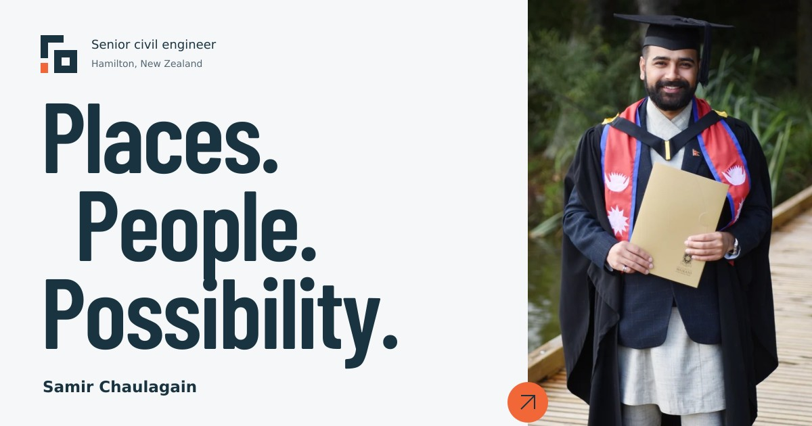

# Samir Chaulagain

An original portfolio for civil engineering, community leadership and digital practice. A concise home page leads into focused practice stories, a personal background and four working lab tools.



## Start locally

Use Node.js 22 or newer.

```bash
npm ci
npm run dev
```

Open **http://localhost:5173**. Source changes trigger a rebuild; refresh your browser to see them.

```bash
npm run check     # build, calculation tests, DOM interaction tests, static checks
npm run build     # generates dist/
npm run preview   # serves the production output locally
```

The published website has **no runtime dependencies**. Happy DOM is a development dependency used to test interactions; it is not shipped to visitors. Building uses Node’s standard library.

## GitHub → Vercel

1. Unzip this package. Put the **contents of `samir-portfolio/`** at the root of your GitHub repository.
2. Import that repository as a new Vercel project.
3. Use these settings if Vercel asks:

| Setting | Value |
| --- | --- |
| Framework preset | Other |
| Root directory | Repository root |
| Build command | `npm run build` |
| Output directory | `dist` |
| Install command | `npm ci` |
| Environment variables | None required |

4. Deploy. `vercel.json` already supplies the build configuration, redirects and security headers.
5. Add `samirchaulagain.com` in Vercel’s domain settings and follow the DNS records Vercel provides. Preview the deployment before changing DNS.

The supplied `dist/` is also ready for a static host. It is ignored by Git because Vercel rebuilds it from the source. Use a web server; opening HTML directly through `file://` will not resolve root-relative links and ES modules correctly.

Official configuration reference: https://vercel.com/docs/builds/configure-a-build

## Pages

| URL | Purpose |
| --- | --- |
| `/` | Concise introduction and selected practices |
| `/about/` | Background, career, qualifications and CPEng goal |
| `/work/engineering/` | Civil design capabilities and delivery approach |
| `/work/community/` | NNZWFS, Engineering NZ Waikato and Nepal Gardens |
| `/work/digital/` | QA, automation, workflows and responsible AI |
| `/lab/` | Four working browser-local tools |
| `/credits/` | Design, assets, references and privacy |
| `/404.html` | Custom not-found page |

Existing `/apps/lab/index.html?tool=…` links redirect to the new lab. Old home-page engineering, community, innovation and journey anchors have compatibility redirects when JavaScript is enabled.

## Edit the content

| File | What to change |
| --- | --- |
| `src/site.mjs` | Name, verified LinkedIn, canonical domain, optional email and CV |
| `src/pages/home.mjs` | Home-page copy and selected practices |
| `src/pages/about.mjs` | Background, career and qualifications |
| `src/pages/practice.mjs` | Engineering, community and digital narratives |
| `src/pages/lab.mjs` | Lab markup, field labels and method notes |
| `src/components.mjs` | Shared header, footer, contact, metadata and visuals |
| `public/assets/styles.css` | Palette, typography, layout and responsive rules |
| `public/assets/js/calculations.js` | Transparent formulas and review-prompt text |
| `public/assets/js/lab.js` | Lab interactions, URL state, copying and downloads |
| `public/assets/images/` | Portrait sizes, original illustrations and social image |

Run `npm run check` after editing.

### Contact and CV

Contact currently opens the verified public LinkedIn profile at `https://nz.linkedin.com/in/samirchlgn`. The original website’s email and CV were placeholders, so they were not carried into the new UI.

To use email, set `email` in `src/site.mjs` to your public address. The contact section switches to email automatically. To publish a CV, place an approved PDF in `public/assets/`, then set `cv` to its root-relative URL. The About page will show the download link.

### Real project stories

The previous site explicitly identified its three mapped developments as fictional demonstration entries. This version presents real capabilities and roles instead. The civil site plan and common-ground graphic are labelled illustrations. Add approved client names, outcomes, drawings and photographs when you have public-release permission; avoid presenting illustration work as a completed commission.

## The lab

- **QuickFlow:** Rational Method peak runoff; explicit hectares, mm/h, L/s and m³/s.
- **GradeCheck:** signed fall, grade, 1-in-N slope and rising/level conditions.
- **BalanceCheck:** reusable material balance on a consistent bank-volume basis, with compacted yield, unsuitable material and loose export separated.
- **Review Workspace:** discipline-specific prompt preparation, copy and text download. No AI API call or document upload.

Numeric calculations can be shared by URL and downloaded as text. Review context is excluded from URLs. Inputs are not sent to a backend, saved to local storage or tracked. Method assumptions and limits appear beside each tool.

## Design and verification

Read `docs/DESIGN.md` for the visual system, `docs/RESEARCH.md` for the audit and design references, and `docs/VALIDATION.md` for the checks and remaining browser QA. Font licenses are included in `public/assets/fonts/`.

This is a complete source package, with a production build included. Browser rendering and manual accessibility checks were not available in the creation environment; perform the short visual acceptance pass in `docs/VALIDATION.md` on your Vercel preview before launch.
